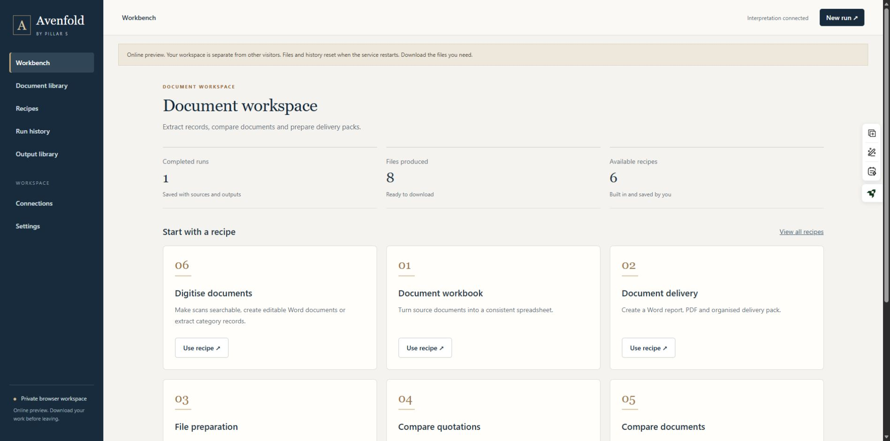

# Avenfold

A document workspace by Pillar 5. Extract records, compare quotations and document versions, digitise scans and organise originals alongside consistent records.

[Open the public preview](https://avenfold.onrender.com/) · [Try the demonstration](docs/DEMONSTRATION.md) · [Architecture](docs/ARCHITECTURE.md)



## What it does

| Task | Output |
| --- | --- |
| Digitise documents | Searchable PDF, editable Word reconstruction or category records |
| Document workbook | Excel and CSV records with source references and checks |
| Document delivery | Word, PDF and Markdown brief, plus a prepared email file |
| File preparation | Extracted text, original files and merged PDF pages |
| Compare quotations | Item prices, supplier terms, amount checks and comparison exports |
| Compare documents | Exact additions, removals and changes to extracted text |
| Document library | Automatic filing, category templates, content search and folder ZIP exports |

Original files remain unchanged. Corrections produce another output revision, and run history records the processing method and events. Missing values remain visible. Model interpretation is optional for tasks that can be completed with rules and file tools.

## See a complete workflow


The animation uses actual screens from a completed scan processing workflow. It is a screen sequence, not a continuous recording. The examples contain fictional organisations and transactions. [Open the guide](docs/DEMONSTRATION.md) for the exact steps and expected values.

The public preview is temporary. Each browser receives a separate workspace, and files reset when the service restarts. Download results you want to keep. The first visit after inactivity can take about a minute.

## Run with Docker

Docker includes Node 24, Python, Poppler, OCR language data and the required fonts.

```sh
git clone https://github.com/Pillar-5/Avenfold.git
cd Avenfold
docker build -t avenfold .
docker run --rm -p 10000:10000 -v avenfold-data:/app/data avenfold
```

Open http://127.0.0.1:10000. This starts the web entry point with separate browser workspaces. The named volume retains server files when this local container is replaced. Keep the browser cookie to return to the same workspace.

To enable automatic interpretation, create a private `.env` file from `.env.example` and set `OPENROUTER_API_KEY`. Start the container with `--env-file .env`. Do not commit the file. Only models with explicit zero prices are eligible. Requests use a zero price ceiling, and failed or invalid responses move to the next eligible model. Free provider quotas still apply.

## Run on a local workstation

Install Node 24 or later, Python 3.10 or later, Poppler and a Unicode TrueType font.

```sh
npm ci
python -m pip install -r requirements.txt
npm run build
npm run samples
node scripts/comparison-samples.mjs
node scripts/library-samples.mjs
python scripts/scanned_sample.py
npm start
```

Open http://127.0.0.1:4317. On Windows, `Start Avenfold.cmd` starts the local service and opens Edge. Set `AVENFOLD_PYTHON`, `AVENFOLD_PDFTOPPM` and `AVENFOLD_OCR_FONT` when the tools are not in their expected locations. The sample generator uses Arial on Windows and DejaVu Sans on Linux.

The local service uses a single workstation workspace. Its watched inbox can process new files using a saved recipe. Its complete data directory should be backed up with the service stopped.

## Inputs and limits

Browser readers accept PDF, DOCX, XLSX, XLS, XLSB, ODS, CSV, TSV, Markdown, text, JSON, HTML, EML, ODT, PPTX and common image formats. Digitisation accepts PDF, PNG, JPEG, WebP, BMP and single page TIFF scans. English, German and French OCR models are included.

Most recipes allow 20 files of up to 10 MB each. Digitisation allows ten files, 30 pages per run and fifteen pages per PDF. OCR pages are limited to 16 megapixels. Quotation comparison accepts two to six offers; document comparison uses exactly two versions. The public preview has additional upload and run limits.

Readers do not guarantee recovery of every element in every document. Embedded media, comments, tracked changes, encrypted files and damaged files may need conversion or separate review. Formula cells use saved values. Word reconstruction approximates layout. Existing PDF text layers are retained. No PDF/A certification is claimed.

## Examples

[Input documents](examples/input) include invoices, scans, client correspondence, quotations and two agreement versions. [Output files](examples/output) were generated and downloaded from the public application. They include actual Excel, Word and PDF files that can be opened independently.

For the scanned invoice, the expected reference is WP0064, the currency is EUR and the total is 300. The image and PDF represent the same invoice for format testing.

## Technical structure

The browser uses PDF.js, Mammoth, SheetJS, Tesseract.js and PostalMime. The server uses SQLite, ExcelJS, docx, pdf-lib, Docxtemplater, PizZip, fflate, Archiver, jsdiff and Chokidar. Python supplies PDF preparation and the invisible OCR layer. No external model is required for OCR, exact text comparison, PDF merging or exports.

See [architecture](docs/ARCHITECTURE.md), [data handling](SECURITY.md) and [upstream components](docs/THIRD_PARTY.md). Dependency licences are also available from the application footer.

## Verification

```sh
npm run check
npm test
```

The verification on 24 November 2026 passed 41 automated tests. All six workbench recipes also completed on Render using fictional documents. Downloaded PDF, Word, Excel and ZIP outputs were independently opened. The checks covered source preservation, OCR, numeric extraction, comparisons, revisions and browser workspace separation. [Verification record](docs/VERIFICATION.md).

For a complete test environment, build the Docker image and run `docker run --rm avenfold npm test`. Workstation OCR tests honour `AVENFOLD_PYTHON` and `AVENFOLD_PDFTOPPM`.

## Deploy

The Dockerfile is ready for a Render web service. Select Docker, use `/api/health` as the health check and set `OPENROUTER_API_KEY` privately if interpretation is needed. `render.yaml` describes the free preview configuration. Free Render storage is temporary; durable hosting requires a separate storage decision.

## Licence

MIT. Copyright 2026 Pillar 5 GmbH. Third party libraries retain their respective licences.
