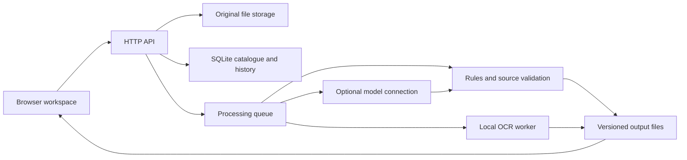

# Architecture

Avenfold uses a Node 24 HTTP service, a browser interface and SQLite. Document readers run in the browser where practical. Scan digitisation runs on the server with local OCR tools.

| Component | Responsibility |
| --- | --- |
| `public/app.mjs` | Recipe selection, upload, review, run history and downloads |
| `public/ingest.mjs` | PDF, Office, spreadsheet, email, text and image readers |
| `server.mjs` | Workspace API, source storage, request checks and output delivery |
| `web.mjs` | Separate browser workspaces for the public preview |
| `lib/worker.mjs` | Persistent run queue, progress, processing and revisions |
| `lib/engine.mjs` | Recipes, labelled extraction, source checks and amount checks |
| `lib/comparison.mjs` | Quotation matching and exact document text comparison |
| `lib/digitize.mjs` | OCR, word review and digitised records |
| `lib/digitize_pages.py` | PDF raster preparation and invisible OCR text layers |
| `lib/library.mjs` | Filing, category schemas, search, archival and folder exports |
| `lib/models.mjs` | Free model eligibility, response checks, ranking and fallback |
| `lib/outputs.mjs` | Excel, Word, PDF, CSV, text, email and ZIP generation |

## Source preservation

Original bytes are saved under a generated identifier and recorded with a SHA256 digest. Extraction metadata and source references are stored separately. Corrections produce new output revisions. They do not alter the original upload.

Scanned PDF pages receive an invisible text layer over their existing artwork. Images are embedded with their original oriented resolution. Existing PDF text layers are retained. Word reconstruction is approximate and requires review for complex layouts.

## Interpretation

Automatic interpretation sends selected extracted text to the configured provider. Candidate models must have explicit zero prices, and requests carry a zero price ceiling. Responses are checked against the source constraints. Provider errors and invalid responses trigger fallback. Rules remain available when interpretation cannot complete.

OCR, exact document comparison, file merging and export generation do not require a language model.

## Storage modes

The local service binds to the loopback interface. Its SQLite catalogue and files belong to the current workstation user.

The web entry point assigns an HttpOnly session cookie and a separate data directory to each browser. Processing jobs share a serial queue. Browser sessions are not organisation accounts. The Render preview uses temporary storage, which resets when its container restarts or sleeps.

## Integrity boundary

Source digests, references and revision history support traceability. The current application does not provide an independently witnessed log, cryptographic approval signatures or a complete organisational authorisation system. A digest stored beside a file is not, by itself, proof against an administrator replacing both.
