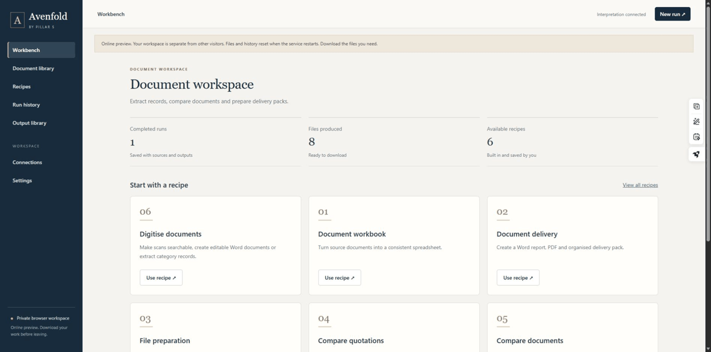
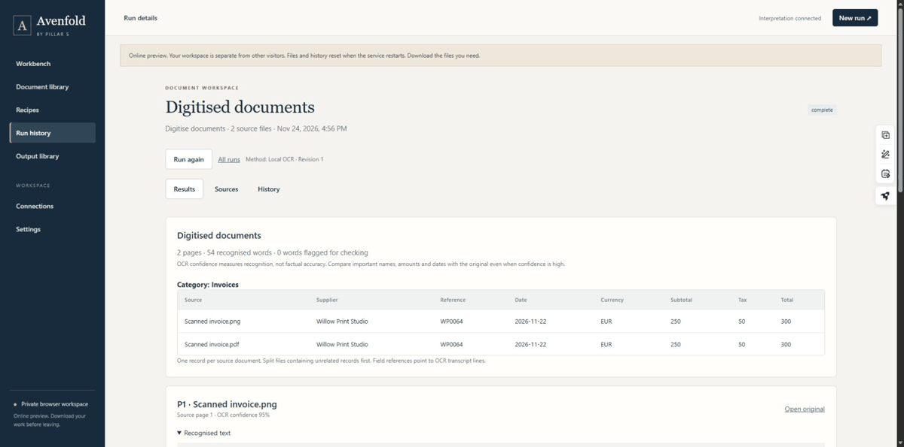

# Demonstration guide

Open [Avenfold](https://avenfold.onrender.com/). No account is needed for the temporary preview. Use the included fictional documents and download the results you want to keep.

## Digitise a scan

1. Choose **Digitise documents** on the workbench.
2. Choose **Load sample documents**, or upload `examples/input/Scanned invoice.png`.
3. Continue to **Output** and select **Category template and spreadsheet**.
4. Keep **Invoices** as the category and create the outputs.
5. Inspect the completed records. The sample contains supplier Willow Print Studio, reference WP0064 and total EUR 300.
6. Expand **Review and correct words** to inspect recognition confidence. Corrections create another output revision.
7. Download the ZIP, searchable PDF, Word record or Excel workbook. Open **History** to inspect the processing events.

The image and PDF samples contain the same invoice for format testing. They should not be counted as two separate business transactions.

This preview is an animated sequence of actual application screenshots. It is not a continuous recording and does not represent processing duration. All displayed records are fictional.

## Compare supplier offers

Open **Compare quotations**, load the samples and create the comparison. Inspect prices alongside quantities, currencies, delivery and payment terms. Overall cost order is not an automatic supplier recommendation. Open a source passage or inspect the exported workbook before confirming an item match.

## Compare document versions

Open **Compare documents**, load the original and revised agreements and choose the original version. Create the comparison, filter additions or removals and inspect the cited passages. The comparison concerns extracted text rather than visual page layout.

## Organise a mixed document pack

Open **Document library**, choose **Add documents** and upload several files from `examples/input`. Choose whether to keep originals with extracted fields or also create standard records. Review the proposed categories, search the contents and export the selected folder as a ZIP.

## Prepare an internal briefing

Open **Document delivery** and load the samples. They contain a client request, operations notes and a client message. Set the required sections and create the Word and PDF brief. Inspect its cited sources and open questions before sharing it. The prepared email is a file for your email application; Avenfold does not send it automatically.

